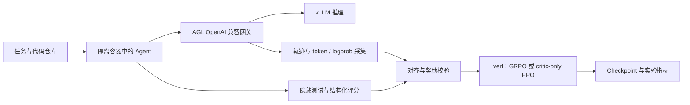

# agl-agentic-rl

**基于 Agent Lightning、verl 与 vLLM 的强化学习与蒸馏实验工程。**

本项目围绕一个问题展开：如何把可验证奖励下的单轮训练，推进到长轨迹、工具调用和隔离执行环境中的 coding agent 训练？工作覆盖训练采集、评测、教师轨迹蒸馏、故障诊断，以及固定 actor 的 PPO critic 预热。

这里既保留有效结果，也保留未获得增益的实验及其排查证据。算法与模型基于上游工作，项目重点是训练系统的可靠性、可复现的实验对照和对失败模式的分析。

**技术栈：** Python · PyTorch · Agent Lightning · verl · vLLM · FSDP · Ray · Kubernetes / Docker · SwanLab

[实验结果与口径](docs/results.md) · [复现指南](docs/reproduction.md) · [文档索引](docs/README.md) · [实验笔记](docs/pitfalls-and-lessons.md)

## 结果概览

以下评测结果截至 **2026-10-15**，critic运行状态更新至 **2026-10-16**。SWE-smith 使用 MiniCPM5-2B 系列模型和固定 474 题验证集；不同起点、轮次预算的结果分别报告。

| 实验线 | 对照 → 结果 | 可以得出的结论 |
|---|---|---|
| GSM8K · Qwen2.5-1.5B-Instruct · GRPO | 825/1319 → 1031/1319，**62.55% → 78.17%** | 全量 test 提升 **15.62 个百分点**；单轮可验证奖励训练 |
| SWE-smith · 官方 SFT 起点 · 40 轮蒸馏 | 92/474 → 硬标签 **126/474**、软标签 **121/474** | 同协议下有提升；属于蒸馏，不能归为 RL 增益 |
| SWE-smith · 官方 SFT 起点 · 100 轮重评 | 100/474 → 硬标签 **117/474**、软标签 **119/474** | 软标签配对 p=0.0271；硬标签 p=0.0568，未达 0.05 |
| SWE-smith · ep3 起点 · GRPO s5 | 134/474 → **135/474** | 配对 p=1.00，未观察到显著提升 |
| SAO/PPO · critic-only | 恢复、更新、保存已验证；后续审计发现摘要终止误判 | **奖励终止语义待修复，actor 保持禁用** |

完整分母、训练起点、评测预算、统计方法与限制见 [结果页](docs/results.md)。这些是本项目的实验读数，不是统一条件下的模型排行榜。

## 核心工程工作

### 1. 让训练样本忠实于实际生成

修复多轮采集中的工具调用丢失、chat-template 参数透传和轨迹合并问题；critic 线进一步核对 sampled token IDs 与 behavior logprobs，保留包含工具结果的完整 response span。缺失奖励、基础设施失败和无法对齐的轨迹直接拒绝，不伪装成零奖励。

入口：[框架补丁](patches/README.md) · [critic 代码包](swe_smith/critic_warmup/README.md)

### 2. 用对照实验判断收益，而非只看训练奖励

实现固定验证集分片评测、逐题结果归档、配对比较、训练日志探针和奖励审计。区分模型起点、交卷率、轮次预算与真实正确率，记录训练奖励上涨但验证集不涨、长度惩罚诱导提前交卷等失败现象。

入口：[SWE-smith 实验](swe_smith/README.md) · [配对比较脚本](swe_smith/harness/paired_cmp.py) · [诊断工具](swe_smith/probes/README.md)

### 3. 跑通教师轨迹与 critic 训练闭环

整理教师输出归一化、成功轨迹筛选、assistant-only SFT、软标签与 OPD 实验；新增冻结 critic attention、固定 actor 的 PPO/GAE 路径，验证原生 critic-only 恢复以及完整分片的原子发布与旧版清理。

入口：[蒸馏与 SFT](swe_smith/README.md#蒸馏与-sft) · [critic 复现包](swe_smith/critic_warmup/README.md)

### 4. 让共享 GPU 环境中的训练可诊断、可停止、可恢复

使用独立运行目录、显式 GPU 选择、奖励与数值检查、磁盘保护和脱敏 tracking。critic 完整 checkpoint 约 22.2 GiB；稳定态只保留最新一份，原子保存期间为新旧两份预留空间。数据盘不足时停止，不转移到根分区。

入口：[critic 工程验收记录](docs/critic-warmup-20261015.md)

## 系统链路



GRPO 与 critic-only PPO 是独立实验线，补丁和配置不可混用；critic-only 路径不更新 actor。

## 从哪里开始

- **快速了解项目：** 本页 → [实验结果](docs/results.md) → [工程经验](docs/README.md)。
- **复现单轮训练：** [GSM8K](gsm8k/README.md)，包含全量评测日志。
- **查看多轮问题排查：** [SWE-smith](swe_smith/README.md)，按训练起点和历史实验线组织；另有[训练脚本导航](swe_smith/training/README.md)与[评测工具导航](swe_smith/harness/README.md)。
- **验证 critic 代码：** [critic 包](swe_smith/critic_warmup/README.md)，可在指定干净上游 checkout 中应用补丁并运行回归测试。

## 目录导航

```text
gsm8k/                 单轮 GRPO 启动、评测、曲线与结果日志
swe_smith/
  agents/              历史 smith agent 与解析/终止相关测试
  training/            GRPO、HMPO 等历史训练配置与入口
  harness/             分片评测、结果汇总和配对比较
  probes/              坍塌探针、奖励审计与权重漂移
  distillation/        教师采集、轨迹归一化与前缀实验
  sft/                 SFT 数据渲染、准备与训练脚本
  critic_warmup/       独立 critic 补丁配套的源码 overlay 与校验工具
  containers/          任务镜像准备工具
  opencode_lineage/    早期 OpenCode 实验归档
patches/               按实验线区分的框架补丁
docs/                  结果口径、复现说明、验收记录与历史笔记
```

## 复现边界与当前状态

这是实验代码与证据仓库，不是 Agent Lightning 的完整 fork。部分脚本保留实验时的路径和环境假设；模型权重、任务镜像、原始轨迹及凭据不随仓库提供。请先阅读 [复现指南](docs/reproduction.md)，不要直接运行历史运维脚本。

2026-10-16的critic有界运行已从完整step40恢复到step200，实际新增155次有效更新，退出码0，最终完整权重仅保留step200。见[最终验收](docs/critic-final-20261016.md)。工程链路通过，actor仍禁用；已准备64题独立留出名单，接下来核验固定actor轨迹并比较常数/初始化基线的value误差与校准，达到质量门槛后再讨论actor更新。

## 上游与致谢

基于 [Microsoft Agent Lightning](https://github.com/microsoft/agent-lightning)、[verl](https://github.com/volcengine/verl)、[vLLM](https://github.com/vllm-project/vllm) 和 SWE-smith 任务体系；GSM8K 训练入口沿用上游示例。本仓库记录实验特定的补丁、脚本与分析，不将上游能力或预训练模型贡献计为新的算法成果。

维护与实验记录约定见 [CONTRIBUTING.md](CONTRIBUTING.md)。
